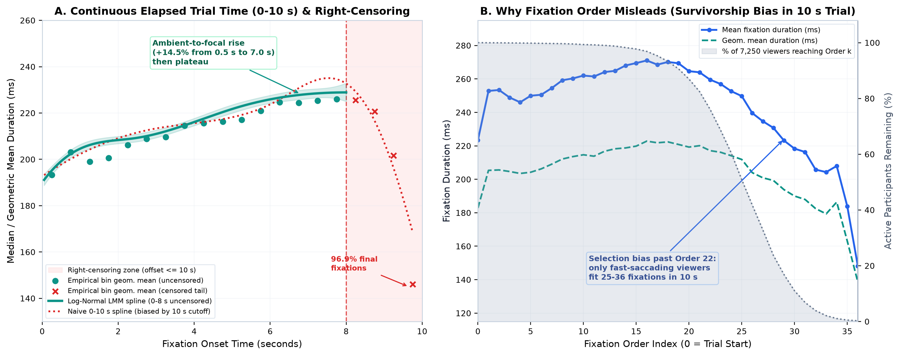
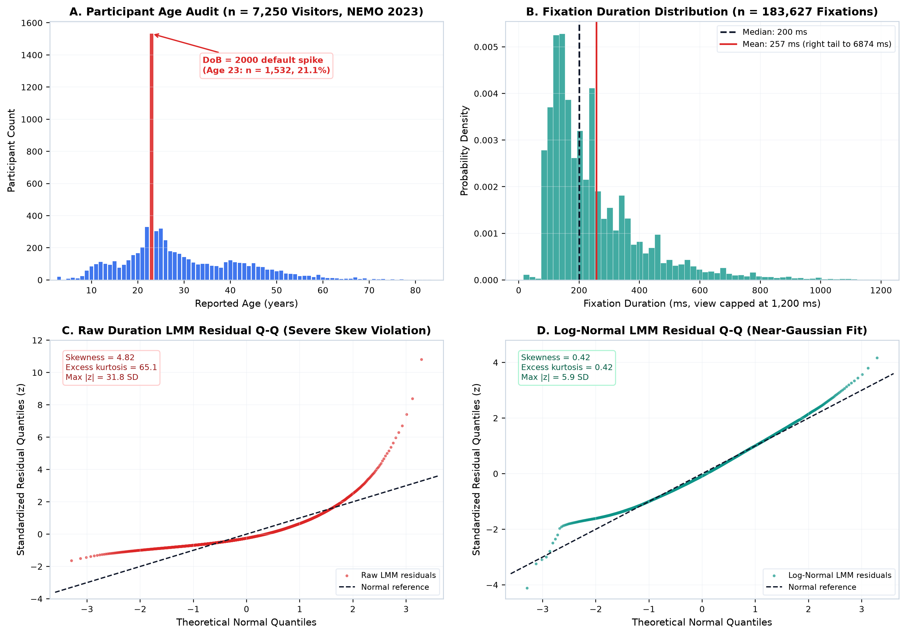
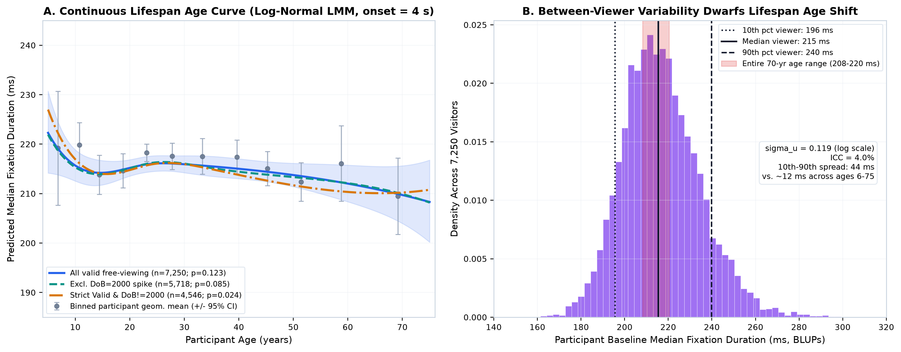
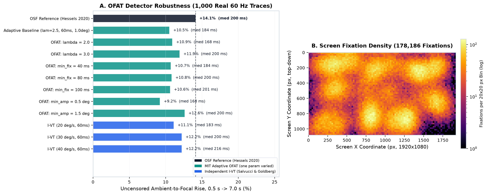

# Eye-Tracking Fixation Duration Analysis (NEMO Science Museum)

Statistical modeling, diagnostic audit, and fixation-detector sensitivity study of **`183,627` eye fixations** from **`7,250` visitors (ages 3 to 93)** viewing a complex natural scene for 10 seconds at the NEMO Science Museum in Amsterdam (Strauch et al., 2023; `60 Hz` infrared eye tracking, [OSF dataset](https://osf.io/sk4fr/)).

Originated as Case Study 1 in the M.Sc. Data Science *Case Studies* course at TU Dortmund University (Prof. Dr. Paul Bürkner & Dr. Šimon Kucharský, Winter Term 2024/25, Group 5) and subsequently refactored into a clean, unit-tested Python pipeline incorporating every methodological review point: auditing a hidden kiosk birth-year default artifact (`DoB = 2000`), replacing skewed raw-scale models with an exact REML/ML Log-Normal Linear Mixed-Effects solver (`src/lmm.py`), separating continuous trial-time dynamics from fixation-order survivorship bias and 10-second right-censoring, and running a true One-Factor-At-a-Time (OFAT) + independent I-VT detector robustness study on `1,000` real `60 Hz` gaze traces.



---

## Research Questions & Core Findings

1. **Lifespan Age Hypothesis:** *Do fixation durations decrease during childhood and increase again later in adulthood (U-shaped trajectory)?*
   - **Finding:** **No U-shaped late-life rebound.** Using continuous cubic B-splines inside a Log-Normal LMM (`log(duration) ~ ns(onset, 5) + ns(age, 5) + (1 | ID)`), predicted median fixation duration shifts by only ~`12 ms` across 70 years (`220 ms` at age 6 -> `214 ms` at age 15 -> `216 ms` at age 25 -> `208 ms` at age 75; `-0.30%/decade`, Age spline LRT $\chi^2 = 8.67, df = 5, p = 0.123$ on `n = 7,250`, and $p = 0.085$ excluding `DoB = 2000`). Even under the strictest validity filter (`n = 4,546`, $p = 0.024$), the pattern is a tiny monotonic childhood shortening (~`10 ms`) with zero older-adult increase, completely dwarfed by between-viewer baseline variability (`ICC = 4.0%`, `10th-90th` percentile BLUP spread = `44 ms`, raw individual spread > `100 ms`).
2. **Temporal Dynamics Over the 10-Second Trial:** *Do fixation durations change systematically over the course of viewing?*
   - **Finding:** **Strong non-linear ambient-to-focal rise followed by a plateau** (consistent with Unema et al., 2005 and Nuthmann et al., 2010). Over the uncensored interior (`onset <= 8.0 s`, where `>99%` of fixations finish naturally), predicted median duration rises **`+14.5%`** from `199.2 ms` (`0.5 s`) to `228.2 ms` (`7.0 s`) before plateauing ($\chi^2 = 1{,}156.2, df = 5, p = 9.2 \times 10^{-248}$; non-linearity vs. linear $\chi^2 = 60.1, p = 2.7 \times 10^{-12}$).
   - **Two critical measurement artifacts exposed:** Naive plots against *fixation order* dip sharply after Order 22 because only fast-saccading viewers can pack 25 to 36 fixations into a 10-second trial (survivorship/selection bias). Similarly, naive fits over all `0-10 s` plunge after `8.5 s` due to hard right-censoring at the 10-second stimulus cutoff (`52.5%` final fixations in `9.0-9.5 s`, `96.9%` in `9.5-10.0 s`).

---

## Data Quality Audit & Model Assumptions

Before inference, auditing the `7,250` valid free-viewing visitors (`183,627` fixations; `9,405` raw participants) revealed two issues that directly shape modeling choices:

1. **Kiosk UI default spike at `DoB = 2000` (`Age = 23`):** Exactly `1,532` visitors (`21.1%` of the cohort) share `DoB = 2000`, nearly `5x` higher than neighboring years (`2001: 329`, `1999: 304`), indicating visitors who left the birth-year picker at its default value. Every model is audited both with and without `DoB = 2000` and under the stricter `Valid = True` flag.
2. **Severe right skew in raw durations:** Fixation durations span `15 ms` to `6,874 ms` (median `200 ms`, mean `257 ms`). A Gaussian LMM on raw duration (`duration ~ Order + (1 | ID)`, verified to reproduce `lme4::lmer` to 5 digits: $\hat{\beta}_0 = 0.2471\ \text{s}$, $\hat{\beta}_{\text{Order}} = 0.001225\ \text{s}$, $\hat{\sigma}_u = 0.05075$, $\hat{\sigma}_e = 0.19534$) exhibits severe residual skewness (`4.82`), excess kurtosis (`65.1`), and outliers up to `31.8 SD`. Modeling $\log(\text{duration})$ cuts skewness to `0.42`, excess kurtosis to `0.42`, and max standardized residual to `5.9 SD`.



---

## Mixed-Effects Model Specification & Cohort Sensitivity

For fixation $j$ of visitor $i$, we fit an exact random-intercept Log-Normal LMM via profiled REML and ML (Woodbury block-diagonal solver in `src/lmm.py`):

$$\log(\text{duration}_{ij}) = \beta_0 + f_{\text{onset}}(\text{onset}_{ij}) + f_{\text{age}}(\text{age}_i) + u_i + \varepsilon_{ij}, \qquad u_i \sim \mathcal{N}(0, \sigma_u^2), \quad \varepsilon_{ij} \sim \mathcal{N}(0, \sigma_\varepsilon^2)$$

where $f_{\text{onset}}$ and $f_{\text{age}}$ are 5-df cubic B-splines evaluated via exact nested ML Likelihood Ratio Tests (`results/model_comparison.csv`):

| Sensitivity Cohort | Fixations ($n$) | Visitors ($G$) | ICC | $R^2_m$ / $R^2_c$ | Onset Rise (`0.5->7.0 s`) | Onset Spline LRT ($p$) | Age Slope (`/10 yr`) | Age Spline LRT ($p$) | Participant KW ($p$) |
| :--- | :---: | :---: | :---: | :---: | :---: | :---: | :---: | :---: | :---: |
| **All valid free-viewing (`onset <= 8 s`)** | **156,598** | **7,250** | 0.040 | 0.7% / 4.7% | **+14.5%** (`199->228 ms`) | $9.2 \times 10^{-248}$ | -0.30% | 0.123 | 0.199 |
| Excl. `DoB = 2000` (`onset <= 8 s`) | 123,214 | 5,718 | 0.040 | 0.7% / 4.7% | **+14.8%** (`200->229 ms`) | $7.0 \times 10^{-198}$ | -0.32% | 0.085 | 0.140 |
| Strict `Valid = True` & `DoB != 2000` | 98,234 | 4,546 | 0.040 | 0.8% / 4.7% | **+15.5%** (`200->231 ms`) | $4.3 \times 10^{-164}$ | -0.51% | 0.024 | 0.023 |
| Excl. initial fixation (`Order > 0`, `<= 8 s`) | 149,348 | 7,247 | 0.040 | 0.5% / 4.5% | **+11.4%** (`206->229 ms`) | $2.7 \times 10^{-162}$ | -0.35% | 0.138 | 0.157 |
| Full `0-10 s` (incl. right-censored tail) | 183,627 | 7,250 | 0.037 | 1.0% / 4.6% | +17.7% *(cutoff bias)* | $< 10^{-300}$ | -0.20% | 0.179 | 0.281 |

*Note: Participant-level Kruskal-Wallis tests across the 11 age brackets are computed on individual visitor means ($G$ independent participants), replacing an earlier course-script bug that ran the test on the 11-row group summary table.*



---

## One-Factor-At-a-Time (OFAT) Detector Robustness

To audit whether conclusions depend on fixation-parsing choices without confounding multiple parameters at once, we drew an age-stratified sample of **`1,000` real `60 Hz` pre-processed gaze traces** and re-extracted fixations across **12 configurations** (`src/fixation_detectors.py`, `results/ofat_robustness.csv`): the OSF Hessels reference, an MIT-licensed adaptive velocity classifier varying one hyperparameter at a time (`lambda`, `min_fix`, `min_amp`), and an independent **I-VT velocity-threshold classifier** (Salvucci & Goldberg, 2000) at `20`, `30`, and `40 deg/s`.

| Detector Configuration (Same 1,000 Visitors) | Fix / Subj | Mean / Med (ms) | Onset Rise (`0.5->7 s`) | Onset LRT ($p$) | Age Slope (`/10 yr`) | Age Spline ($p$) |
| :--- | :---: | :---: | :---: | :---: | :---: | :---: |
| **OSF Reference (Hessels 2020)** | 25.4 | 254.8 / 200.0 | **+14.1%** | $2.2 \times 10^{-29}$ | -0.53% | 0.217 |
| Adaptive Baseline ($\lambda = 2.5$, 60 ms, 1.0 deg) | 32.0 | 230.2 / 184.0 | **+10.5%** | $1.5 \times 10^{-34}$ | -1.12% | 0.005 |
| OFAT: $\lambda = 2.0$ *(only)* | 31.6 | 214.0 / 168.0 | **+10.9%** | $3.0 \times 10^{-31}$ | -1.23% | 0.002 |
| OFAT: $\lambda = 3.0$ *(only)* | 31.3 | 249.7 / 200.0 | **+11.9%** | $2.7 \times 10^{-39}$ | -0.40% | 0.358 |
| OFAT: `min_fix = 40 ms` *(only)* | 33.2 | 224.1 / 184.0 | **+10.7%** | $2.2 \times 10^{-38}$ | -1.38% | 0.0003 |
| OFAT: `min_fix = 80 ms` *(only)* | 30.2 | 240.0 / 200.0 | **+10.8%** | $9.7 \times 10^{-34}$ | -0.77% | 0.056 |
| OFAT: `min_fix = 100 ms` *(only)* | 27.6 | 254.3 / 201.0 | **+10.6%** | $2.0 \times 10^{-28}$ | -0.49% | 0.350 |
| OFAT: `min_amp = 0.5 deg` *(only)* | 34.0 | 210.1 / 168.0 | **+9.2%** | $2.5 \times 10^{-30}$ | -0.90% | 0.013 |
| OFAT: `min_amp = 1.5 deg` *(only)* | 29.9 | 251.9 / 200.0 | **+12.6%** | $9.5 \times 10^{-36}$ | -1.34% | 0.002 |
| Independent I-VT (`20 deg/s`, 60 ms) | 31.7 | 223.6 / 183.0 | **+11.1%** | $2.7 \times 10^{-37}$ | -1.92% | $< 0.0001$ |
| Independent I-VT (`30 deg/s`, 60 ms) | 31.6 | 241.6 / 200.0 | **+12.2%** | $1.1 \times 10^{-40}$ | -1.64% | 0.0001 |
| Independent I-VT (`40 deg/s`, 60 ms) | 30.1 | 265.2 / 216.0 | **+12.2%** | $1.1 \times 10^{-38}$ | -1.88% | $< 0.0001$ |

### Key Robustness Insights

1. **Temporal ambient-to-focal effect is invariant:** Across all 12 detector and hyperparameter variations, the uncensored `0.5 s -> 7.0 s` rise stays between **`+9.2%` and `+14.1%`** ($p \le 2 \times 10^{-28}$ everywhere).
2. **Velocity threshold (`lambda`, I-VT threshold) and merge amplitude (`min_amp`) shift absolute medians most:** Changing $\lambda$ (`2.0 -> 3.0`), `min_amp` (`0.5 -> 1.5 deg`), or I-VT threshold (`20 -> 40 deg/s`) shifts median duration by `32-33 ms`, whereas `min_fix` (`40 -> 100 ms`) shifts it by `17 ms`.
3. **Why adaptive thresholds matter for lifespan studies:** Fixed-threshold I-VT (`20-40 deg/s`) induces a slight negative age slope (`-1.6%` to `-1.9%` per decade, $p \le 10^{-4}$) because fixed cutoffs fragment noisier recordings (e.g., older visitors wearing glasses) into shorter fixations. Noise-adaptive thresholding (Hessels $\lambda = 2.5$ to $3.0$) absorbs per-viewer tracking noise and removes that artifact (`-0.40%` to `-0.53%`/decade, $p > 0.21$).



---

## Repository Structure

```text
.
├── src/
│   ├── lmm.py                 # Exact Woodbury REML/ML random-intercept LMM, cubic B-splines, LRTs, R^2
│   ├── fixation_detectors.py  # MIT adaptive velocity classifier (Hessels 2020) & I-VT (Salvucci & Goldberg 2000)
│   └── run_analysis.py        # End-to-end analysis, DoB=2000 audit, OFAT sweep, CSV export, and 4 figures
├── tests/
│   └── test_pipeline.py       # Unit tests for REML recovery, spline LRTs, and synthetic fixation detection
├── results/
│   ├── age_group_summary.csv  # Participant-level descriptive statistics across 11 age brackets
│   ├── model_comparison.csv   # Nested Log-Normal LMM LRTs, ICC, R^2, and diagnostics across 5 cohorts
│   └── ofat_robustness.csv    # 12-configuration OFAT & I-VT robustness table on 1,000 real 60 Hz traces
├── figures/                   # Diagnostic plots generated by src/run_analysis.py
├── requirements.txt           # Minimal scientific stack (numpy, scipy, pandas, matplotlib)
└── LICENSE                    # MIT License
```

## Quick Start

```bash
git clone https://github.com/r-a-j/Eye-Tracking-Fixations.git
cd Eye-Tracking-Fixations
python -m venv .venv
source .venv/bin/activate   # On Windows: .venv\Scripts\activate
pip install -r requirements.txt

# Run unit tests (no external dataset required)
python -m unittest discover -s tests -v

# Reproduce full analysis after downloading the public NEMO dataset (https://osf.io/sk4fr/)
python -m src.run_analysis --data-dir /path/to/compiled_data --preproc-dir /path/to/pre_processed_updated
```

---

## References

- **Strauch, C., Hoogerbrugge, A. J., Baer, G., et al. (2023).** *Saliency models perform best for women's and young adults' fixations.* Communications Psychology, 1(1), 34. Dataset: https://osf.io/sk4fr/
- **Hessels, R. S., Van Doorn, A. J., Benjamins, J. S., Holleman, G. A., & Hooge, I. T. C. (2020).** *Task-related gaze control in human crowd navigation.* Attention, Perception, & Psychophysics, 82, 2482-2501.
- **Salvucci, D. D., & Goldberg, J. H. (2000).** *Identifying fixations and saccades in eye-tracking protocols.* Proceedings of ETRA 2000, 71-78.
- **Nuthmann, A., Smith, T. J., Engbert, R., & Henderson, J. M. (2010).** *CRISP: A computational model of fixation durations in scene viewing.* Psychological Review, 117(2), 382-405.
- **Unema, P. J. A., Pannasch, S., Joos, M., & Velichkovsky, B. M. (2005).** *Time course of information processing during scene perception: The relationship between saccade amplitude and fixation duration.* Visual Cognition, 12(3), 473-494.
- **Course:** *Case Studies (Eye-Tracking)*, Prof. Dr. Paul Bürkner & Dr. Šimon Kucharský, Department of Statistics, TU Dortmund University (Winter Term 2024/25).
